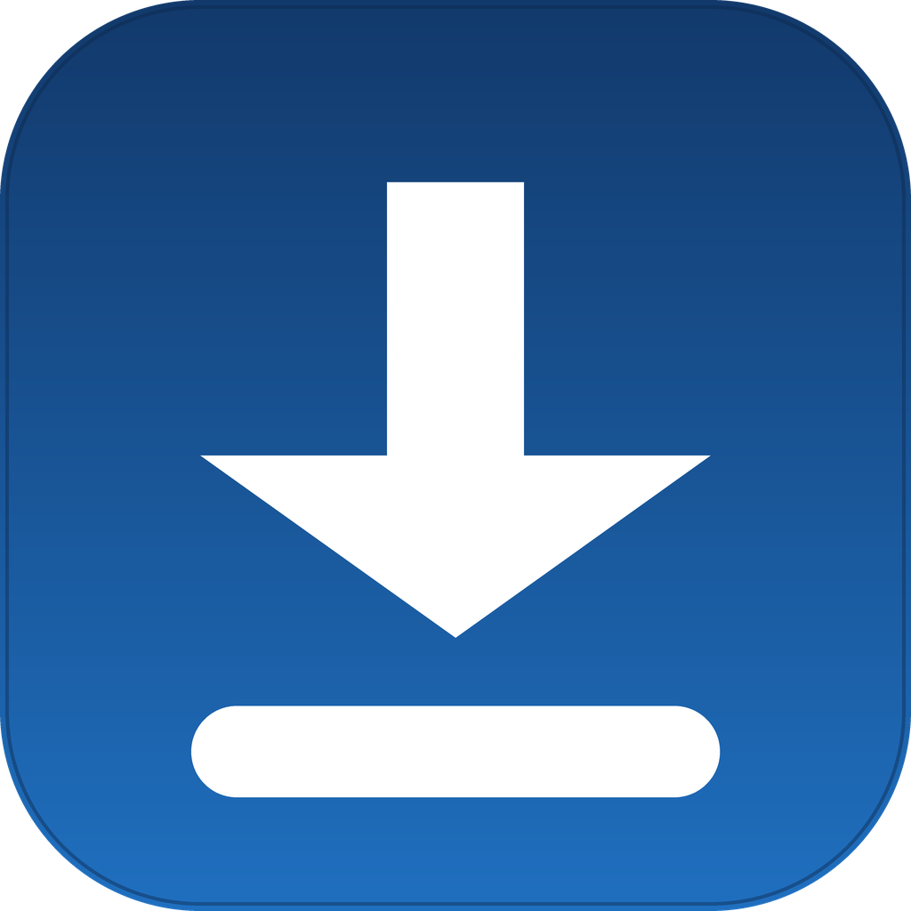
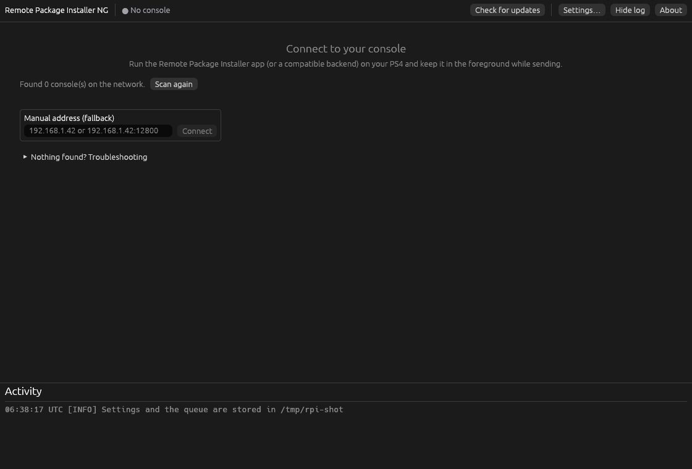
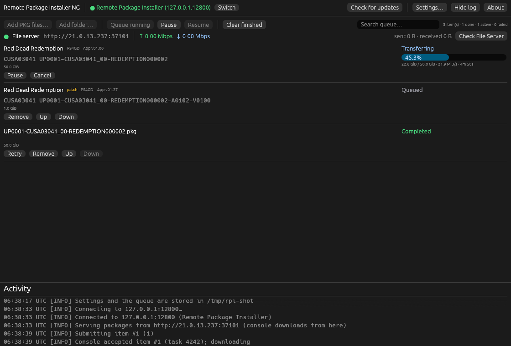

<p align="center">
  
</p>

<h1 align="center">Remote Package Installer NG</h1>

<p align="center">
  <strong>Put PS4 games on your console over your home network. No USB stick, no FTP.</strong>
</p>

<p align="center">
  <a href="https://github.com/AldySan/Remote-Package-Installer-NG/releases/latest"></a>
  <a href="LICENSE"></a>
  
  
</p>

A free, open-source desktop app for **Windows**, **macOS** and **Linux**. You pick the game files (`.pkg`) on your computer, and the app sends them straight to your PS4 over your own network, with live progress, pause and resume. It is a PC companion for the package installer that already runs on your console, so nothing about your PS4 gets modified.

**[Download the latest release](https://github.com/AldySan/Remote-Package-Installer-NG/releases/latest)** · [How to use](#how-to-use) · [Common problems](#common-problems) · [For developers](#for-developers)

## Screenshots

| Connect to your console | Queue with a live transfer |
| --- | --- |
|  |  |

## Features

- **Automatic console discovery.** The app scans your local network for PS4s running a compatible installer, and shows every one it finds. Consoles you connected to before are kept on the list for next time.
- **Manual address fallback.** If the scan comes up empty, type the console's IP address and port (for example `192.168.1.42` or `192.168.1.42:9090`) and connect directly.
- **Queued installs.** Line up as many packages as you like, in order. Reorder them while they wait, pause the active one, cancel it, retry a failed one, or remove it. One item installs at a time, because that is how the console works.
- **Live progress.** Each item shows a progress bar with percent, transferred size, transfer speed and remaining time, plus a separate state for the console-side install phase.
- **Real package knowledge.** Files are read on your computer before anything is sent: game or add-on type, patch flag, title and title ID from the package's own metadata. Multipart packages (`.pkg` split into numbered pieces) are grouped automatically, and duplicates are caught on add.
- **Honest completion.** An item is only marked done when the console actually reports the full transfer plus its copy phase. If the connection drops, the app checks with the console what really happened instead of guessing, and lets you decide (mark completed or retry).
- **Failure policy.** Choose what happens when a transfer fails: keep going with the rest of the queue, or pause it until you say otherwise.
- **Built-in diagnostics.** While you are connected, the app shows its file server's address with live in/out rates and session totals, and a one-click **Check File Server** self-test that tells you whether the problem is on your computer or between the two machines.
- **Search.** Filter the queue by title, file name, title ID or content ID.
- **Activity log.** Every connection, transfer and repair is written to a colored, timestamped log you can show or hide.
- **Portable.** Settings and the queue are stored as small JSON files next to the app itself. Copy the folder and your setup travels with it. The log tells you the exact location on every start.
- **Light and quiet.** Written in Rust with a native UI. No accounts, no telemetry, no background services. The app only talks to your console, and to GitHub when it checks for updates (which you can turn off).

## What you need

- A PS4 with [GoldHEN](https://github.com/GoldHEN/GoldHEN), using the **Package Installer** inside it. ([RPI NextGen](https://github.com/AldySan/ps4_remote_pkg_installer_nextgen) works too.)
- Your PS4 and your computer on the **same network**: same Wi-Fi or the same router.
- Your own `.pkg` game files, saved anywhere on your computer. The app does not come with games and does not download anything.

## Getting started

1. Download the archive for your system from the [Releases](https://github.com/AldySan/Remote-Package-Installer-NG/releases) page and unpack it anywhere you like:
   - Windows: `RemotePackageInstallerNG-vX.Y.Z-Windows-x64.zip`
   - macOS: `RemotePackageInstallerNG-vX.Y.Z-macos-universal.zip` (works on every Mac)
   - Linux: `RemotePackageInstallerNG-vX.Y.Z-Linux-x64.tar.gz` (includes a `linux/` folder with optional menu-shortcut files if you want the app in your launcher)
2. Run the app.
3. The first run may need a small bypass, because the downloads are not signed:
   - **Windows:** a blue "Windows protected your PC" window may appear. Click *More info*, then *Run anyway*.
   - **macOS:** if the app "cannot be verified", right-click it, choose *Open*, then *Open* again. Needed only the first time.
4. That's it. See [How to use](#how-to-use) for the actual workflow.

## How to use

1. **On the PS4**, open GoldHEN and start **Package Installer**. Keep it on screen the whole time: the PS4 pauses apps that go to the background.
2. **On your computer**, start the app. It looks for your PS4 on its own. If nothing shows up, type the PS4's IP address instead. You'll find it on the console under *Settings → Network → View Connection Status*.
3. Add your `.pkg` files: drag and drop them in, use **Add PKG files…**, or add a whole folder with **Add folder…**.
4. Press **Start queue**.
5. When the app says an item is **Done**, the game appears on your PS4's home screen.

While the queue runs you can watch the speed and remaining time for each item, pause or cancel the active one, and rearrange or remove the ones still waiting. If the app or the console gets interrupted mid-transfer, reconnect on the next start: the app asks the console what actually finished and continues from there, so nothing is blindly sent twice.

## Common problems

- **No PS4 shows up.** Make sure the installer is open on the console (not sitting in the background) and both machines are on the same network, with no guest-network or AP isolation in between. Typing the IP manually helps; with some GoldHEN versions you need to add the port, like `192.168.1.20:9090`.
- **A firewall message appears on your computer.** Allow it. The PS4 downloads the files from your computer, so the app needs to accept that connection.
- **An install stops halfway.** The PS4 probably put the installer app in the background. Open it again on the console, then reconnect in the app; it will figure out where things stand and continue from there.
- **The console won't download, but the app looks fine.** Press **Check File Server** on the file-server line. If the check passes, the block is between the two machines (firewall, network); if it fails, the message tells you where to look.
- **Anything else.** [Open an issue](https://github.com/AldySan/Remote-Package-Installer-NG/issues) and describe what you did and what happened. Reports genuinely help.

## Settings

Open **Settings…** in the top bar. Everything is optional and saved as you leave it:

| Setting | What it does |
| --- | --- |
| Theme | Follow your system, or force light or dark. |
| File server port | Automatic by default; set a fixed port if your network needs one. Applies the next time you connect. |
| Scan for consoles automatically | Turn off the network scan at startup and connect by hand. |
| Progress polling | How often the app asks the console for progress (250 to 5000 ms). |
| Include subfolders by default | Preselects the recursive option when you add a folder. |
| Start the next item automatically | Turn off to install one package at a time, manually. |
| When a transfer fails | Continue with the next package, or pause the queue. |
| Check for updates on startup | A plain request to GitHub for the latest release tag. Nothing else is sent. |

## For developers

The app is a Rust workspace with two crates:

```
crates/
  rpi-ng-core/    all product logic: engine, queue, file server, PS4 protocol,
                  discovery, PKG/SFO parsing, persistence (no UI dependencies)
  rpi-ng/         the desktop UI (egui), kept thin over the core
```

The core is fully usable headless, which is how the whole test suite runs in CI without a display or a console: a mock PS4 speaks the wire protocol, including its known quirks.

```sh
git clone https://github.com/AldySan/Remote-Package-Installer-NG.git
cd Remote-Package-Installer-NG
cargo test --workspace --locked
cargo build --release --locked
```

Rust 1.95 or newer is required. Before opening a pull request, also run `cargo clippy --workspace --all-targets -- -D warnings` and `cargo fmt --all -- --check` (CI enforces both). See [CONTRIBUTING.md](CONTRIBUTING.md) for the full workflow.

More documentation lives in the [docs folder](docs/):

- [docs/BUILDING.md](docs/BUILDING.md): building, testing and packaging from source
- [docs/ARCHITECTURE.md](docs/ARCHITECTURE.md): how the engine, queue and protocol layers fit together
- [docs/TESTING.md](docs/TESTING.md): what the test suite covers, and what it deliberately does not claim
- [MIGRATION.md](MIGRATION.md): moving over from other tools and workflows

## Contributing

Issues and pull requests are welcome, including small fixes and beginner questions. Start with [CONTRIBUTING.md](CONTRIBUTING.md), and please read [CODE_OF_CONDUCT.md](CODE_OF_CONDUCT.md) first. The [issues page](https://github.com/AldySan/Remote-Package-Installer-NG/issues) always has something pickable.

## Support development

If this app saved you an evening of USB shuffling, there are three easy ways to say thanks:

- Leave a ⭐ star on the repository. It genuinely helps other people find the project.
- Tell a friend who still copies packages the slow way.
- Buy me a coffee on [Ko-fi](https://ko-fi.com/aldysan). Entirely optional, always appreciated.

None of this is required. The app is free, and it stays free.

## License

GPL-3.0. See [LICENSE](LICENSE).

The original [ps4_remote_pkg_installer](https://github.com/flatz/ps4_remote_pkg_installer) ships no license, so nothing was copied from it: the protocol here was re-implemented from reading its source. Discovery and probing patterns were informed by [pkg-sender](https://github.com/Loopayeh/pkg-sender) (MIT), also re-implemented from scratch.

## Contributors

- [AldySan](https://github.com/AldySan)
